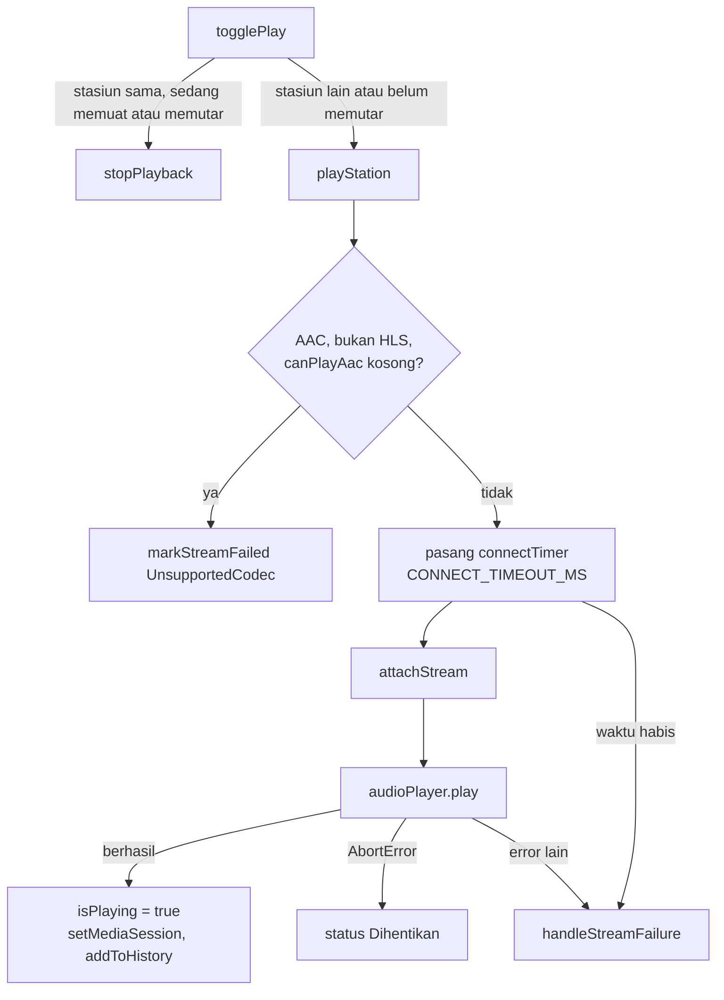
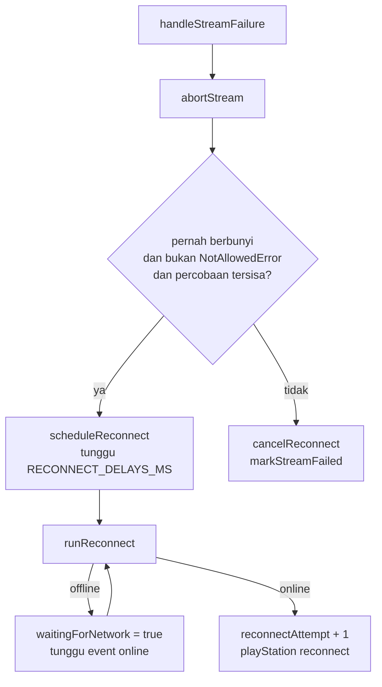

# Arsitektur streaming

Dokumen ini menjelaskan cara Dengaran memutar stream radio di browser: jalur pemutaran yang dipilih, batas waktu, sambung ulang, dan pesan kegagalan. Kodenya ada di `src/app.js`, bagian `// ---------- Pemutaran ----------` dan `// ---------- Media Session ----------`. Fungsi dan konstanta disebut dengan namanya, bukan nomor baris, supaya bisa dicari dengan `grep`.

Kalau kode streaming diubah, dokumen ini diperbarui di commit yang sama.

## Sumber stream

Dengaran tidak punya server stream. URL stream diambil dari [Radio Browser](https://www.radio-browser.info), dan audio diunduh browser langsung dari server stasiun. Dengaran tidak melakukan transcode atau proxy.

Akibatnya, format, codec, dan bitrate ditentukan oleh stasiun. Satu stasiun di Radio Browser punya satu URL stream. Stream yang diterima Dengaran ada dua jenis:

| Jenis | Contoh | Cara diputar |
|---|---|---|
| Stream HTTP biasa (Icecast, Shoutcast) | MP3, AAC, Ogg | langsung oleh elemen `<audio>` |
| HLS | URL `.m3u8`, atau `hls = 1` di data Radio Browser | `<audio>` di Safari, hls.js di browser lain |

## Elemen audio dan state

Seluruh pemutaran memakai satu elemen: `<audio id="audioPlayer" preload="none">` di `src/index.html`. Dengan `preload="none"` tidak ada data stream yang diunduh sebelum pengguna menekan Putar.

State pemutaran disimpan di variabel modul:

| Variabel | Isi |
|---|---|
| `currentStation` | stasiun yang sedang dipilih di player |
| `isConnecting` | sedang menyambung, termasuk saat menunggu sambung ulang |
| `isPlaying` | audio sudah berbunyi |
| `isBuffering` | sedang memutar tetapi data stream belum datang |
| `streamAttached` | ada stream yang terpasang ke elemen audio |
| `playRequestId` | nomor urut permintaan putar, lihat bagian berikut |
| `reconnectAttempt` | jumlah percobaan sambung ulang yang sudah dijalankan |
| `waitingForNetwork` | sambung ulang ditahan karena perangkat offline |

Tombol putar hanya punya empat tampilan (`PLAY_STATES`): `idle`, `stopped`, `connecting`, dan `playing`. Tidak ada tombol jeda. Siaran live tidak bisa dilanjutkan dari posisi lama, jadi Putar selalu memuat ulang stream dan mulai dari siaran yang sedang berjalan.

### `playRequestId`

Memasang stream adalah proses asynchronous: hls.js mungkin perlu diunduh, dan `audioPlayer.play()` mengembalikan promise. Selama itu pengguna bisa memilih stasiun lain atau menekan Stop.

Setiap `playStation` menaikkan `playRequestId` dan menyimpan nilainya. Setiap langkah sesudah `await`, timer, dan handler error hls.js membandingkan nilai yang disimpan dengan `playRequestId` saat ini. Kalau berbeda, permintaan itu sudah diganti dan hasilnya diabaikan. `abortStream` juga menaikkan `playRequestId`, jadi promise yang masih tertunda dari stream yang dilepas ikut diabaikan.

## Alur Putar

Langkah `playStation` secara berurutan:

1. Hapus timer stream. Kalau pemutaran dimulai pengguna, batalkan sambung ulang yang sedang berjalan (`cancelReconnect`).
2. Naikkan `playRequestId`, set state ke menyambung, hapus tanda gagal stasiun ini dari `failedStations`.
3. Kalau stasiun AAC, bukan HLS, dan browser menyatakan tidak bisa memutar AAC: hentikan stream sebelumnya dan langsung gagal. Lihat bagian Deteksi AAC.
4. Kalau bukan sambung ulang: reset `listenSeconds`, simpan stasiun ke `LAST_STATION_KEY`, dan kirim `reportClick` ke Radio Browser. Sambung ulang tidak dihitung sebagai klik baru.
5. Pasang `connectTimer` dengan `CONNECT_TIMEOUT_MS`.
6. `attachStream`, lalu `audioPlayer.play()`.
7. Kalau berhasil: hapus timer, set `isPlaying`, isi Media Session, tambahkan ke Baru diputar.

## Pemilihan jalur pemutaran

`attachStream` memilih jalur:

| Kondisi | Jalur |
|---|---|
| `isHlsStation` dan `canPlayType("application/vnd.apple.mpegurl")` kosong | hls.js dengan Media Source Extensions |
| selain itu | `audioPlayer.src = station.url` |

`isHlsStation` membaca `station.hls` dari Radio Browser. Favorit yang disimpan sebelum field itu ada dikenali dari URL yang berakhir `.m3u8`.

Pada jalur hls.js, stream sebelumnya dihentikan dulu supaya tidak tetap terdengar selama hls.js diunduh. `loadHls` memuat `HLS_SCRIPT` sekali dan memakai ulang promise-nya. Kalau script gagal dimuat, promise dihapus supaya percobaan berikutnya memuat ulang. Kalau `Hls.isSupported()` false (browser tanpa Media Source Extensions), `attachStream` melempar error dan stream gagal.

Error hls.js yang tidak fatal dipulihkan sendiri oleh hls.js. Error fatal diteruskan ke `handleStreamFailure`, sama dengan event `error` elemen audio.

### `HLS_CONFIG`

| Opsi | Nilai | Alasan |
|---|---|---|
| `enableWorker` | `false` | Worker hls.js dibuat dari `blob:` URL dan diblokir CSP. Transmux stream audio dijalankan di main thread. |
| `liveSyncDurationCount` | `3` | Mulai 3 segmen di belakang ujung playlist live, batas minimum spesifikasi HLS. |
| `maxLiveSyncPlaybackRate` | `1.05` | Tertinggal 3 sampai 6 segmen: putar sampai 1.05x sampai kembali ke posisi live. Pitch tetap karena `preservesPitch` elemen audio aktif secara default. |
| `liveMaxLatencyDurationCount` | `6` | Tertinggal lebih dari 6 segmen: seek langsung ke posisi live. |
| `maxBufferLength` | `10` | Batas buffer di depan posisi putar, dalam detik. |
| `backBufferLength` | `10` | Batas buffer di belakang posisi putar, dalam detik. |

Pemilihan bitrate (ABR) memakai default hls.js. ABR hanya berlaku kalau playlist stasiun menyediakan lebih dari satu bitrate.

hls.js disimpan di `src/vendor/hls-<versi>.light.min.js`. Saat versinya diganti, `HLS_SCRIPT` dan `THIRD_PARTY_NOTICES.md` ikut diubah.

## Deteksi AAC

Sebagian browser tidak punya decoder AAC, misalnya ABP browser di Android. Browser itu tidak mengirim event `error`: koneksi tersambung, lalu audio tidak pernah berbunyi sampai `CONNECT_TIMEOUT_MS` habis.

Supaya pengguna tidak menunggu, `playStation` memeriksa lebih dulu:

- `isAacStation`: field `codec` dari Radio Browser diawali `AAC` (Radio Browser menulis `AAC` atau `AAC+`). Favorit lama tanpa field `codec` tidak dikenali sebagai AAC.
- `canPlayAac`: `canPlayType("audio/aac")` atau `canPlayType('audio/mp4; codecs="mp4a.40.2"')` tidak kosong. Dua MIME type dicek karena browser berbeda mengenali bentuk yang berbeda.

Kalau stasiun AAC dan keduanya kosong, stream langsung gagal dengan `UnsupportedCodec` dan tombol Coba lagi disembunyikan, karena mencoba lagi tidak mengubah dukungan format. Stasiun HLS dilewati dari pemeriksaan ini, karena hls.js memutarnya lewat Media Source Extensions, yang dukungan formatnya tidak diukur `canPlayType`.

Ada browser yang menyatakan bisa memutar AAC padahal tidak. Kasus itu baru terdeteksi saat `CONNECT_TIMEOUT_MS` habis, dan pesannya menyebut dua kemungkinan penyebab: stasiun offline, atau browser tidak bisa memutar AAC.

## Batas waktu

| Konstanta | Nilai | Dipakai untuk |
|---|---|---|
| `CONNECT_TIMEOUT_MS` | 12000 | dari `playStation` sampai audio berbunyi |
| `STALL_TIMEOUT_MS` | 15000 | dari event `waiting` atau `stalled` sampai data stream datang lagi |

Stream yang tersambung tetapi tidak mengirim data tidak memicu event `error`, jadi kedua timer ini satu-satunya cara mendeteksinya. Keduanya memanggil `failAfter`, yang meneruskan `TimeoutError` ke `handleStreamFailure` kalau `playRequestId` belum berubah.

### Event `stalled` di Chrome

`stalled` dan `waiting` ditangani fungsi yang sama, `handleAudioWaiting`, yang menyimpan `bufferingStartTime` dan memasang `stallTimer`.

Chrome mengirim `stalled` kalau data stream tidak datang sekitar 3 detik, walaupun audio masih berbunyi dari buffer. Event `playing` tidak menyusul karena audio tidak pernah berhenti. Karena itu `handleAudioTimeUpdate` memeriksa: kalau `isBuffering`, audio tidak di-pause, dan `currentTime` sudah melewati `bufferingStartTime`, buffering dianggap selesai dan `handleAudioPlaying` dipanggil. Tanpa pemeriksaan ini, `stallTimer` menghentikan stream yang masih berbunyi.

## Sambung ulang

`handleStreamFailure` memutuskan apakah stream disambung ulang atau dinyatakan gagal:

Aturannya:

- **Hanya stream yang sudah pernah berbunyi** yang disambung ulang (`isPlaying` atau `reconnectAttempt > 0`). Stream yang gagal sebelum berbunyi berarti stasiun offline atau URL rusak, jadi langsung gagal.
- **`NotAllowedError` tidak disambung ulang.** Error ini berarti browser memblokir autoplay. Stasiunnya tidak rusak, dan pengguna cukup menekan Putar lagi.
- **Jeda per percobaan** dari `RECONNECT_DELAYS_MS`: 1, 2, 4, 8, lalu 15 detik. Sesudah lima percobaan gagal, pesan kegagalannya `ConnectionLost`.
- **Offline.** `runReconnect` memeriksa `navigator.onLine`. Kalau offline, `reconnectAttempt` tidak dinaikkan dan percobaan ditahan sampai event `online` (`handleOnline`).
- **Reset jumlah percobaan.** `reconnectAttempt` kembali ke 0 sesudah stream hasil sambung ulang berbunyi selama `RECONNECT_RESET_SECONDS` (10 detik, dihitung dari `streamSeconds`). Tanpa batas ini, server yang memutus koneksi setiap beberapa detik akan disambung ulang tanpa henti.
- **Aksi pengguna membatalkan sambung ulang.** Menekan Putar, Stop, atau stasiun lain memanggil `cancelReconnect`.

## Event elemen audio

Didaftarkan di bagian inisialisasi `src/app.js`. Handler `playing`, `pause`, `error`, dan `ended` keluar lebih dulu kalau `streamAttached` false, jadi event dari stream yang sudah dilepas tidak mengubah state. Handler `waiting` keluar kalau `isPlaying` false.

| Event | Handler | Perilaku |
|---|---|---|
| `playing` | `handleAudioPlaying` | hapus timer, set `isPlaying`, status "Sedang memutar." |
| `waiting`, `stalled` | `handleAudioWaiting` | set `isBuffering`, pasang `stallTimer` |
| `timeupdate` | `handleAudioTimeUpdate` | akhiri buffering (lihat bagian Chrome), hitung `listenSeconds` dan `streamSeconds`, reset `reconnectAttempt` |
| `pause` | `handleAudioPause` | jeda dari luar halaman (tombol headset, Bluetooth lepas) diperlakukan sebagai Stop |
| `error` | `handleAudioError` | `handleStreamFailure` |
| `ended` | `handleAudioEnded` | stream live tidak punya akhir, jadi `ended` berarti server menutup koneksi: `handleStreamFailure` |

`handleAudioTimeUpdate` hanya menambahkan selisih `currentTime` yang lebih dari 0 dan kurang dari 2 detik. Selisih yang lebih besar berarti seek, bukan waktu yang didengar.

## Pesan kegagalan

`markStreamFailed` menandai stasiun di `failedStations` (tampil sebagai label di kartunya), lalu `streamFailureMessage` memilih pesan berdasarkan `error.name`:

| Kondisi | Pesan untuk pengguna | Tombol Coba lagi |
|---|---|---|
| `NotAllowedError` | Browser menahan audio. Tekan Putar sekali lagi. Stasiun tidak ditandai gagal. | disembunyikan |
| `UnsupportedCodec` | Format AAC tidak didukung browser ini. | disembunyikan |
| `ConnectionLost` | Koneksi terputus dan tidak bisa disambung ulang. | tampil |
| `TimeoutError`, stasiun AAC | Stasiun mungkin offline, atau browser tidak bisa memutar AAC. | tampil |
| `TimeoutError` | Stasiun tidak merespons. | tampil |
| stream `http:` di halaman HTTPS | Stream HTTP diblokir browser di halaman HTTPS. | tampil |
| selain itu | Stasiun mungkin sedang offline. | tampil |

Pesan AAC dimulai dengan faktanya, bukan nama stasiun, karena di HP status terpotong satu baris dan nama stasiun sudah tampil di atasnya.

## Stop dan tutup player

- `abortStream` melepas stream: naikkan `playRequestId`, hapus timer, `detachStream` (hancurkan instance hls.js), pause, hapus `src`, lalu `load()`.
- `stopPlayback` memanggil `abortStream` dan `cancelReconnect`, lalu set Media Session ke `paused`. Stasiun tetap di player.
- `closePlayer` melakukan hal yang sama, lalu menghapus stasiun dari player, menghapus `LAST_STATION_KEY`, dan mengosongkan Media Session.

## Media Session

`setMediaSession` dipanggil sesudah audio berbunyi. Metadata yang diisi: `title` nama stasiun, `artist` nama negara, `album` "Dengaran". Tidak ada gambar karena logo stasiun tidak ditampilkan.

| Action | Perilaku |
|---|---|
| `play` | `playStation(currentStation)` kalau tidak sedang memutar atau menyambung |
| `pause`, `stop` | `stopPlayback` |
| `nexttrack`, `previoustrack` | `playAdjacent(1)` dan `playAdjacent(-1)` |

`setMediaAction` membungkus `setActionHandler` dengan `try`, karena browser lama melempar error untuk action yang tidak didukungnya.

## HTTPS dan CSP

- Di halaman HTTPS (`SECURE_PAGE`), pencarian mengirim `is_https=true` ke Radio Browser, jadi hanya stasiun dengan stream HTTPS yang tampil. Stasiun HTTP di Favorit atau Baru diputar tetap tampil dengan label `HTTP` (`isInsecureStream`).
- CSP dibuat oleh `scripts/build_public.py` ke `public/_headers`. `media-src https: blob:` mengizinkan stream HTTPS dari server stasiun mana pun, dan `blob:` dipakai Media Source Extensions untuk hls.js. `connect-src` memuat `https:` supaya hls.js bisa mengambil playlist dan segmen dari server stasiun mana pun.
- `python3 -m http.server` tidak membaca `_headers`, jadi perubahan CSP baru bisa dicek sesudah deploy.

## Yang tidak dibuat

Fitur di bawah ini adalah teknik optimasi streaming yang umum dipakai di web player audio. Semuanya tidak ada di kode Dengaran.

| Fitur | Status dan alasan teknis |
|---|---|
| ABR dengan varian bitrate sendiri (32 kbps Opus, 64 kbps AAC, 128 kbps AAC) | Butuh server yang meng-encode stream ke beberapa bitrate. Dengaran tidak punya server stream. ABR hanya berjalan lewat default hls.js untuk stasiun HLS yang menyediakan beberapa bitrate. |
| Prioritas codec Opus | Satu stasiun di Radio Browser punya satu URL dan satu codec, jadi tidak ada alternatif codec yang bisa dipilih. |
| Catch-up `playbackRate` untuk stream Icecast | Hanya dibuat untuk HLS, lewat `maxLiveSyncPlaybackRate`. Stream HTTP biasa tidak memberi posisi live yang bisa dijadikan acuan. |
| `preload="metadata"` | Dipakai `preload="none"`. `preload="metadata"` membuka koneksi ke server stasiun sebelum Putar ditekan, dan stream live tidak punya durasi untuk dibaca. |
| Visualizer atau EQ dengan Web Audio API | Belum dibuat. `MediaElementAudioSourceNode` dari stream lintas origin hanya menghasilkan sunyi kalau server stasiun tidak mengirim header CORS. Animasi equalizer untuk penanda stasiun aktif juga tidak dipakai. |
| Page Visibility API untuk menurunkan animasi | Tidak ada animasi yang berjalan terus selama memutar, selain ikon loader saat menyambung. |
| Judul lagu real-time (WebSocket, SSE, atau ICY metadata) | Belum dibuat. Radio Browser tidak menyediakan judul lagu. ICY metadata ada di dalam stream dan tidak dibuka oleh elemen `<audio>`. Membacanya lewat `fetch` butuh header CORS dari server stasiun. |
| Telemetry pemutaran ke backend | Belum dibuat. Dengaran adalah situs statis di Cloudflare Pages tanpa backend. Yang ada hanya Cloudflare Web Analytics untuk jumlah kunjungan, dan `reportClick` ke Radio Browser untuk ranking stasiun. |
